<p align="center">
  
</p>

<p align="center">
  <a href="https://github.com/ishandutta2007/Awesome-Awesome-Awesome"></a>
  <a href="https://discord.gg/jc4xtF58Ve"></a>
  <a href="https://github.com/ishandutta2007/Awesome-No-Code-Development-Platform/stargazers"></a>
  <a href="https://github.com/ishandutta2007/Awesome-No-Code-Development-Platform/network/members"></a>
  <a href="https://github.com/ishandutta2007/Awesome-No-Code-Development-Platform/issues"></a>
  <a href="https://github.com/ishandutta2007/Awesome-No-Code-Development-Platform/blob/main/LICENSE"></a>
  <a href="https://github.com/ishandutta2007/Awesome-No-Code-Development-Platform/pulls"></a>
  <a href="https://github.com/ishandutta2007"></a>
</p>

---

# 🚀 Awesome No-Code & Low-Code Development Platforms

> **A rigorously curated directory of SaaS market leaders, visual app builders, self-hosted internal developer tooling, and open-source ecosystems.**  
> *Empowering developers, citizen builders, and enterprise architects with rapid visual development, zero-lock-in self-hosting, and AI-accelerated workflows.*

---

## 📑 Table of Contents

- [🌐 Sector Overview & Market Dynamics](#-sector-overview--market-dynamics)
- [🏢 SaaS & Hosted Enterprise Platforms](#-saas--hosted-enterprise-platforms)
- [🔓 Open-Source GitHub Projects (Ranked by Stars)](#-open-source-github-projects-ranked-by-stars)
- [🧭 Decision Framework: Which Platform Should You Choose?](#-decision-framework-which-platform-should-you-choose)
- [🤝 How to Contribute](#-how-to-contribute)
- [💖 Support & Community](#-support--community)
- [⭐ Star History](#--star-history)
- [📜 Disclaimer & Governance](#-disclaimer--governance)

---

## 🌐 Sector Overview & Market Dynamics

The global **Low-Code and No-Code Development Platform Market** was valued at approximately **$30.5 billion in 2024–2025** and is projected to surpass **$115+ billion by 2030–2032**, registering a compound annual growth rate (CAGR) of **~25–28%**. This rapid expansion is catalyzed by global developer shortages, escalating demand for bespoke internal software, and the widespread convergence of Generative AI Copilots that convert natural language prompts directly into full-stack CRUD applications.

### 📊 Fragmentation vs. Concentration Dynamics
The sector exhibits a **moderately fragmented** structure rather than a singular winner-take-all monopoly:
- **Enterprise Hyperscalers & Legacy Titans** (*Microsoft Power Apps, OutSystems, Mendix, Appian*): Hold deep dominance across Fortune 500 enterprises, regulated verticals, and complex mission-critical ERP backbones due to comprehensive IT governance and compliance certifications.
- **Specialized Best-of-Breed Leaders** (*Retool for developer internal tools, Bubble for startup MVPs, Webflow for high-end design, FlutterFlow for native mobile*): Enjoy formidable competitive moats and high customer retention within specific vertical workflows.
- **Self-Hosted Open-Source Challengers** (*n8n, Supabase, Appsmith, ToolJet, NocoBase, Baserow*): Rapidly gaining enterprise market share as engineering teams prioritize data sovereignty, compliance (GDPR/HIPAA/SOC 2), self-managed infrastructure, and freedom from punitive per-seat pricing models.

---

## 🏢 SaaS & Hosted Enterprise Platforms

The table below catalogs premier commercial SaaS platforms, ranked in **descending order by company scale (market capitalization or valuation)**.

| 🏢 Platform | 💰 Company Scale / Valuation | 🏷️ Starting Tier Price | 🎁 Free Tier / Trial Limit | 🎯 Best For & Core Capabilities |
| :--- | :--- | :--- | :--- | :--- |
| [**Microsoft Power Apps**](https://powerapps.microsoft.com/) | **~$3.1 Trillion** *(Microsoft Market Cap; Power Platform ~$2.5B+ ARR)* | **$20/user/month** *(Power Apps Premium; or $5/user/app/month standalone)* | **30-Day Free Trial** *(Full sandbox environment); or Free renewable **90-Day Microsoft 365 Developer sandbox** (25 user licenses)* | Enterprise organizations deeply embedded in Microsoft 365, Dynamics, Azure, and Dataverse desiring centralized IT administration and AI Copilot. |
| [**OutSystems**](https://www.outsystems.com/) | **$9.5 Billion** *(Valuation; $572M raised, ~$300M+ ARR)* | **$1,500/month** *(billed annually for Single Application package)* | **Free Edition Forever** *(Up to 100 end users, 1 shared cloud personal environment, 0.25 GB database, community support)* | Large enterprise fusion teams building mission-critical core banking, logistics, and high-load web/mobile systems requiring strict DevOps governance. |
| [**Webflow**](https://webflow.com/) | **$4.0 Billion** *(Valuation; $335M raised, ~$150M+ ARR)* | **$14/month** *(billed annually for Basic Site plan; $19/seat/mo for Workspace)* | **Free Starter Plan Forever** *(Up to 2 unhosted staging pages, 50 CMS database items, 1 GB bandwidth, `webflow.io` subdomain)* | Designers, marketing agencies, and founders seeking pixel-perfect, semantic HTML5/CSS3/JS visual web design and CMS without coding. |
| [**Retool**](https://retool.com/) | **$3.2 Billion** *(Valuation; $127M raised, ~$100M+ ARR)* | **$10/standard user/month + $5/end user/month** *(billed annually for Team plan)* | **Free Plan Forever** *(Up to 5 total users, unlimited web/mobile apps, Retool Database with 5 GB storage, all 50+ DB/API connectors)* | Engineering and DevOps teams needing to build internal admin panels, customer support tooling, and database CRUD UIs at 10x speed. |
| [**Appian**](https://appian.com/) | **~$2.2 Billion** *(Public Market Cap: NASDAQ `APPN`, ~$550M+ ARR)* | **$75/user/month** *(Standard Application plan; tiered volume pricing)* | **Community Edition Free Forever** *(1 dedicated personal cloud sandbox environment, full BPM workflow engine, guided training paths)* | Heavily regulated industries (banking, healthcare, federal government) needing end-to-end case management, data fabric, and compliance automation. |
| [**Mendix**](https://www.mendix.com/) | **$730 Million** *(Acquired by Siemens; Siemens DI Software unit ~$400M+)* | **$60/month** *(Basic plan for up to 5 named users, billed annually)* | **Free Edition Forever** *(Up to 5 named users per app, 1 Mendix Cloud sandbox environment, 0.5 GB storage)* | Industrial and enterprise organizations creating unified web/mobile applications with model-driven architecture and SAP/Siemens connectivity. |
| [**Bubble**](https://bubble.io/) | **$480 Million** *(Valuation; $100M+ raised, ~$50M ARR)* | **$29/month** *(billed annually for Starter plan, or $32/mo monthly)* | **Free Plan Forever** *(Full visual editor, development sandbox, 50,000 workload units/mo, `bubbleapps.io` subdomain, Bubble badge)* | Non-technical founders, solopreneurs, and agile product teams launching database-driven MVPs and production SaaS products without writing code. |
| [**FlutterFlow**](https://flutterflow.io/) | **~$170 Million** *(Valuation; Google Ventures backed, ~$25M ARR)* | **$30/month** *(billed annually for Standard plan, or $39/mo monthly)* | **Free Plan Forever** *(Visual Flutter UI builder, test runs, Firebase integration, 2 API endpoints, web preview; excludes source code/APK export)* | Mobile and web creators needing native iOS/Android performance, Supabase/Firebase integrations, and full exportable Dart/Flutter source code ownership. |
| [**Glide**](https://www.glideapps.com/) | **~$100 Million** *(Valuation; Benchmark backed, ~$15M ARR)* | **$49/month** *(billed annually for Maker plan, or $60/mo monthly)* | **Free Plan Forever** *(Up to 3 apps, 1 editor seat, 10 personal users, 500 rows of data, `glide.page` subdomain)* | Operations teams, field workers, and SMBs turning Google Sheets, Excel files, and Airtable bases into modern mobile PWAs in minutes. |
| [**Betty Blocks**](https://www.bettyblocks.com/) | **~$70 Million** *(Valuation; European VC backed, ~$12M ARR)* | **$1,150/month** *(Standard Application tier, billed annually)* | **30-Day Free Sandbox Trial** *(Full sandbox access, up to 5 builder seats, access to block templates; no credit card required)* | Mid-market and enterprise organizations empowering citizen developers within strictly governed, IT-approved security frameworks. |

---

## 🔓 Open-Source GitHub Projects (Ranked by Stars)

The following open-source solutions provide self-hosted freedom, data ownership, zero per-seat licensing penalties, and transparent extensibility. Repositories are sorted in **descending order by GitHub Stars_Count**.

---

### 1. [n8n](https://github.com/n8n-io/n8n)
[](https://github.com/n8n-io/n8n/stargazers)
- **Primary Focus**: Fair-code workflow automation and AI agent orchestration.
- **Tech Stack**: TypeScript, Node.js, Vue.js.
- **License**: Sustainable Use License (Fair-code).
- **Core Capabilities**: 400+ native connectors, visual node-based graph editor, native LangChain and autonomous AI agent execution, custom JavaScript/Python code execution, and single-container Docker or Kubernetes deployment.
- **Best For**: Technical teams orchestrating complex multi-system data flows, automated backends, and AI pipelines without SaaS subscription overhead.

---

### 2. [Langflow](https://github.com/langflow-ai/langflow)
[](https://github.com/langflow-ai/langflow/stargazers)
- **Primary Focus**: Dynamic visual UI canvas for building multi-agent AI systems and RAG architectures.
- **Tech Stack**: Python, React, TypeScript.
- **License**: MIT.
- **Core Capabilities**: Drag-and-drop canvas for any LLM, vector store, embedding model, and memory component. Instant API endpoint generation from visual flows, multi-agent collaboration, and seamless LangChain integration.
- **Best For**: AI engineers and developers seeking to prototype, test, and deploy production-grade LLM applications visually.

---

### 3. [Supabase](https://github.com/supabase/supabase)
[](https://github.com/supabase/supabase/stargazers)
- **Primary Focus**: The open-source Firebase alternative with built-in visual data studio.
- **Tech Stack**: PostgreSQL, Elixir, TypeScript, Go.
- **License**: Apache-2.0.
- **Core Capabilities**: Dedicated PostgreSQL database with visual Table Editor, auto-generated REST and GraphQL APIs, real-time WebSocket subscriptions, built-in Authentication, Edge Functions, and vector embeddings (`pgvector`).
- **Best For**: Full-stack engineers and no-code builders seeking a production-grade relational backend with visual management and instant APIs.

---

### 4. [AppFlowy](https://github.com/AppFlowy-IO/AppFlowy)
[](https://github.com/AppFlowy-IO/AppFlowy/stargazers)
- **Primary Focus**: Open-source, privacy-first Notion and Airtable alternative.
- **Tech Stack**: Flutter, Rust.
- **License**: AGPL-3.0.
- **Core Capabilities**: Local-first architecture, rich visual database views (Kanban, Grid, Calendar), offline support, end-to-end data encryption, and self-hosted AI assistance.
- **Best For**: Teams and individuals requiring collaborative workspaces, documentation, and relational task management with total data sovereignty.

---

### 5. [Strapi](https://github.com/strapi/strapi)
[](https://github.com/strapi/strapi/stargazers)
- **Primary Focus**: Developer-first open-source headless CMS and visual content modeling studio.
- **Tech Stack**: Node.js, TypeScript, React.
- **License**: MIT / Community Edition.
- **Core Capabilities**: Visual Content-Type Builder, granular role-based access control (RBAC), media asset library, auto-generated REST/GraphQL endpoints, and an extensive plugin ecosystem.
- **Best For**: Content-heavy web applications, multi-channel mobile apps, and editorial teams needing an intuitive visual publishing interface.

---

### 6. [NocoDB](https://github.com/nocodb/nocodb)
[](https://github.com/nocodb/nocodb/stargazers)
- **Primary Focus**: Open-source smart spreadsheet and relational database builder (Airtable alternative).
- **Tech Stack**: Node.js, Vue.js, TypeScript.
- **License**: AGPL-3.0.
- **Core Capabilities**: Connects directly to existing PostgreSQL, MySQL, MariaDB, and SQLite databases to transform them into interactive spreadsheets. Provides Grid, Gallery, Form, and Kanban views, automations, and REST API generation.
- **Best For**: Non-technical team members and business analysts who need to collaborate on relational enterprise data through a familiar spreadsheet interface.

---

### 7. [PocketBase](https://github.com/pocketbase/pocketbase)
[](https://github.com/pocketbase/pocketbase/stargazers)
- **Primary Focus**: Lightweight open-source real-time backend contained in a single Go binary.
- **Tech Stack**: Go, SQLite, Svelte.
- **License**: MIT.
- **Core Capabilities**: Embedded SQLite with real-time subscriptions, visual admin dashboard for schema building, user authentication with OAuth2, file storage (local or S3), and client SDKs (JS, Dart/Flutter).
- **Best For**: Rapid prototyping, indie hackers, and lightweight web/mobile applications needing zero-maintenance self-hosting.

---

### 8. [Twenty](https://github.com/twentyhq/twenty)
[](https://github.com/twentyhq/twenty/stargazers)
- **Primary Focus**: Modern open-source CRM and no-code custom business object platform (Salesforce alternative).
- **Tech Stack**: TypeScript, NestJS, React, PostgreSQL.
- **License**: AGPL-3.0.
- **Core Capabilities**: Highly visual data modeling for custom business objects, fields, and relations. Real-time collaboration, GraphQL API, email sync, and built-in AI assistant for CRM workflows.
- **Best For**: Startups and modern businesses wanting an extensible, beautifully designed, open-core customer operating system without enterprise bloat.

---

### 9. [Flowise](https://github.com/FlowiseAI/Flowise)
[](https://github.com/FlowiseAI/Flowise/stargazers)
- **Primary Focus**: Drag-and-drop visual UI for building custom LLM agents and multi-prompt chains.
- **Tech Stack**: TypeScript, Node.js, React.
- **License**: MIT.
- **Core Capabilities**: Visual node connectors for LangChain components, memory stores, document loaders, vector databases, and tools. Embeddable chatbot widgets and instant REST API generation.
- **Best For**: Teams and product managers looking to assemble custom conversational AI assistants and automated customer support bots without coding.

---

### 10. [ToolJet](https://github.com/ToolJet/ToolJet)
[](https://github.com/ToolJet/ToolJet/stargazers)
- **Primary Focus**: AI-assisted enterprise low-code internal tool builder.
- **Tech Stack**: TypeScript, NestJS, React.
- **License**: AGPL-3.0 / MIT Core.
- **Core Capabilities**: Connects to 100+ databases, APIs, and cloud services (PostgreSQL, MongoDB, BigQuery, Snowflake, Google Sheets). AI app generator that produces editable components, built-in ToolJet DB, custom JS/Python queries, and native MCP server for Claude Code/Codex integration.
- **Best For**: Mid-market and enterprise teams seeking to replace Retool with an open-source, AI-augmented internal tool platform.

---

### 11. [Appsmith](https://github.com/appsmithorg/appsmith)
[](https://github.com/appsmithorg/appsmith/stargazers)
- **Primary Focus**: Developer-focused low-code application platform with native Git integration.
- **Tech Stack**: Java, TypeScript, React.
- **License**: Apache-2.0.
- **Core Capabilities**: 45+ customizable UI widgets (tables, charts, forms, modals) that bind dynamically to SQL/REST/GraphQL data. Native Git integration enabling branch-based CI/CD pipelines, JS transformations, Docker/Kubernetes self-hosting, and SOC 2 / HIPAA compliance.
- **Best For**: Software engineering teams who require low-code build speed without sacrificing professional DevOps practices, source control, and deployment freedom.

---

### 12. [Directus](https://github.com/directus/directus)
[](https://github.com/directus/directus/stargazers)
- **Primary Focus**: Flexible open-source data studio and API engine for any SQL database.
- **Tech Stack**: Node.js, TypeScript, Vue.js.
- **License**: BSL-1.1 / GPL-3.0.
- **Core Capabilities**: Instantly mirrors any SQL database (PostgreSQL, MySQL, SQLite, Oracle, MS SQL) with zero migration or proprietary schema lock-in. Generates dynamic REST and GraphQL APIs, visual dashboards, granular RBAC, and event-driven webhooks.
- **Best For**: Engineering teams seeking an instant, zero-lock-in no-code data management layer over existing production databases.

---

### 13. [Reflex](https://github.com/reflex-dev/reflex)
[](https://github.com/reflex-dev/reflex/stargazers)
- **Primary Focus**: Full-stack web application framework built purely in Python.
- **Tech Stack**: Python, FastAPI, Next.js / React (compiled).
- **License**: Apache-2.0.
- **Core Capabilities**: Write frontend, backend logic, and database queries in pure Python. Compiles to an optimized Next.js frontend with 60+ pre-built UI components and an AI app generator.
- **Best For**: Python developers, data scientists, and ML practitioners wanting to ship interactive web applications without learning JavaScript or React.

---

### 14. [Budibase](https://github.com/Budibase/budibase)
[](https://github.com/Budibase/budibase/stargazers)
- **Primary Focus**: Open-source operations platform for building internal apps, automations, and AI agents.
- **Tech Stack**: TypeScript, Node.js, Svelte.
- **License**: GPL-3.0 (Client libraries MPL).
- **Core Capabilities**: Auto-generated CRUD screens from database connections, role-based access control (RBAC), multi-step automation engine, self-hosted user portal, and pre-built integrations with PostgreSQL, MySQL, MSSQL, MongoDB, and REST.
- **Best For**: IT managers, operations leads, and DevOps engineers needing to quickly turn internal databases into polished employee portals.

---

### 15. [NocoBase](https://github.com/nocobase/nocobase)
[](https://github.com/nocobase/nocobase/stargazers)
- **Primary Focus**: Highly extensible plugin-driven open-source no-code platform for enterprise systems.
- **Tech Stack**: Node.js, TypeScript, Ant Design, Koa.
- **License**: AGPL-3.0.
- **Core Capabilities**: 100% plugin-based architecture. Visual data modeling for PostgreSQL/MySQL, block-based UI building (tables, forms, charts, kanban), embedded AI employees in workflows, and fine-grained permissions.
- **Best For**: Teams needing an adaptable, self-hosted enterprise no-code core that can be extended with custom plugins and AI capabilities.

---

### 16. [Teable](https://github.com/teableio/teable)
[](https://github.com/teableio/teable/stargazers)
- **Primary Focus**: Super-fast real-time no-code database built natively on PostgreSQL.
- **Tech Stack**: TypeScript, Next.js, PostgreSQL, Prisma.
- **License**: AGPL-3.0.
- **Core Capabilities**: High-performance spreadsheet interface scaling to millions of records without lag. Full SQL capabilities underneath, real-time multi-user collaboration, automated REST API, and native Airtable migration.
- **Best For**: Businesses hitting performance and row limits on Airtable who require native PostgreSQL speed, reliability, and self-hosting.

---

### 17. [Amplication](https://github.com/amplication/amplication)
[](https://github.com/amplication/amplication/stargazers)
- **Primary Focus**: Enterprise backend code generation platform for Node.js and TypeScript.
- **Tech Stack**: TypeScript, NestJS, Prisma, React.
- **License**: Apache-2.0.
- **Core Capabilities**: Visually model data schemas and relationships, then auto-generate production-grade NestJS backends with clean GraphQL/REST APIs, Prisma ORM, role-based auth, and automated GitHub PR creation.
- **Best For**: Backend developers wanting to eliminate boilerplate CRUD setup while retaining full ownership of clean TypeScript code.

---

### 18. [ILLA Cloud](https://github.com/illacloud/illa-builder)
[](https://github.com/illacloud/illa-builder/stargazers)
- **Primary Focus**: Open-source low-code internal tool builder with AI agent integrations.
- **Tech Stack**: Go, TypeScript, React.
- **License**: Apache-2.0.
- **Core Capabilities**: Drag-and-drop component canvas with real-time multi-developer collaboration. Integrates with PostgreSQL, MySQL, Redis, REST APIs, Hugging Face, and custom AI agents.
- **Best For**: Global development teams looking for a fast, collaborative open-source alternative to Retool and ToolJet.

---

### 19. [Baserow](https://github.com/baserow/baserow)
[](https://github.com/baserow/baserow/stargazers)
- **Primary Focus**: Modular open-source no-code database, application, and automation builder.
- **Tech Stack**: Python, Django, Vue.js, Nuxt.js, PostgreSQL.
- **License**: AGPL-3.0.
- **Core Capabilities**: Four integrated modules: Database Builder (relational models, 30+ field types), Application Builder (client portals), Automation Builder, and Baserow AI. API-first architecture generating automatic Swagger documentation.
- **Best For**: Privacy-conscious organizations migrating from Airtable who need modular app building and self-hosted GDPR/HIPAA compliance.

---

### 20. [Saltcorn](https://github.com/saltcorn/saltcorn)
[](https://github.com/saltcorn/saltcorn/stargazers)
- **Primary Focus**: Completely free, end-to-end open-source no-code web application builder.
- **Tech Stack**: JavaScript, Node.js, PostgreSQL, SQLite.
- **License**: MIT.
- **Core Capabilities**: True zero-cost no-code application builder. Includes a visual page builder, relational database manager, authentication system, and an active plugin store for custom widgets and themes.
- **Best For**: Community groups, non-profits, educators, and hobbyists building full-stack web applications without SaaS fees or vendor lock-in.

---

### 21. [Lowcoder](https://github.com/lowcoder-org/lowcoder)
[](https://github.com/lowcoder-org/lowcoder/stargazers)
- **Primary Focus**: Lightweight open-source internal tool platform with JavaScript extensions.
- **Tech Stack**: TypeScript, React, Java.
- **License**: AGPL-3.0.
- **Core Capabilities**: Responsive UI drag-and-drop layout builder, custom React component embedding, enterprise SSO integration, and direct connectivity to databases and REST APIs.
- **Best For**: Engineering teams looking for a lightweight, self-hostable internal tool solution with flexible custom React extensions.

---

## 🧭 Decision Framework: Which Platform Should You Choose?

```
                                  What is your primary goal?
                                               │
             ┌─────────────────────────────────┼─────────────────────────────────┐
             │                                 │                                 │
     Public Customer App                Internal Tooling                  Database / Workflows
             │                                 │                                 │
    ┌────────┴────────┐               ┌────────┴────────┐               ┌────────┴────────┐
    │                 │               │                 │               │                 │
 Web App           Mobile App     Code-Friendly    Fast Citizen     Smart Sheet     Automation
    │                 │               │            Dev Portal           │                 │
Bubble /          FlutterFlow     Appsmith /        Retool /        NocoDB /            n8n /
Webflow                            ToolJet          Budibase        Baserow           Langflow
```

- **Choose [Bubble](https://bubble.io/) or [Webflow](https://webflow.com/)** if you are launching an external customer-facing MVP, marketing hub, or responsive web portal without writing frontend code.
- **Choose [FlutterFlow](https://flutterflow.io/)** if you need pixel-perfect, native cross-platform iOS & Android apps with full Flutter source code ownership.
- **Choose [Appsmith](https://github.com/appsmithorg/appsmith) or [ToolJet](https://github.com/ToolJet/ToolJet)** if you are an engineering team building custom admin panels and internal dashboards connected directly to production databases with Git CI/CD.
- **Choose [NocoDB](https://github.com/nocodb/nocodb), [Teable](https://github.com/teableio/teable), or [Baserow](https://github.com/baserow/baserow)** if you want an Airtable-style relational spreadsheet with full self-hosting and zero row limits.
- **Choose [n8n](https://github.com/n8n-io/n8n) or [Langflow](https://github.com/langflow-ai/langflow)** if you need visual orchestration, AI agent pipelines, and automated multi-system integrations.
- **Choose [Microsoft Power Apps](https://powerapps.microsoft.com/) or [OutSystems](https://www.outsystems.com/)** if you require enterprise-grade governance, compliance certifications, and deep Office 365 or SAP integration across thousands of corporate users.

---

## 🤝 How to Contribute

Contributions are warmly encouraged! Help keep this no-code directory comprehensive, unbiased, and up-to-date:

1. **Fork the Repository** on GitHub.
2. **Create a Feature Branch**: `git checkout -b feature/add-new-platform`.
3. **Add or Update Entries**:
   - Provide the platform name, official website, and GitHub repository (if open-source).
   - Detail specific pricing tiers and free limits (avoid ambiguous terms like "Custom" or "Usage-based").
   - Follow the existing formatting and table/bullet structure.
4. **Submit a Pull Request** with a concise description of your additions.

---

## 💖 Support & Community

Thank you for visiting and using the **Awesome No-Code Development Platform** ecosystem! 🌟

If you find this directory valuable for your architectural evaluations, startup builds, or internal tooling strategies:
- ⭐ **Star this repository** to help fellow developers discover it.
- 🍴 **Fork and share** with your engineering team, agency, or tech community.
- 📢 **Join our community** on [Discord](https://discord.gg/jc4xtF58Ve) to discuss low-code architectures, self-hosting, and AI agents.
- ☕ **Support the Maintainer**: Consider sponsoring the creator via the [GitHub Sponsor Dashboard](https://github.com/sponsors/ishandutta2007) to help sustain ongoing curation, open-source benchmarking, and community updates!

---

##  Star History

[](https://star-history.dera.page/#ishandutta2007/Awesome-No-Code-Development-Platform&type=date&legend=top-left)

---

## 📜 Disclaimer & Governance

- **Independent Community Curation**: This repository is a community-driven compilation created for educational and technical comparison purposes. It is neither affiliated with nor endorsed by any listed company.
- **Pricing & Tier Volatility**: SaaS pricing models, free tier quotas, and corporate valuations fluctuate regularly. Please consult each vendor's official pricing page for up-to-the-minute commercial terms.
- **Self-Hosting Security Responsibilities**: Deploying open-source solutions shifts operational responsibilities (including SSL/TLS termination, automated database backups, vulnerability patching, and resource isolation) to your infrastructure team. Always adhere to enterprise security best practices when deploying in production environments.

---

<p align="center">
  <b>Built with ❤️ for citizen developers, software engineers, and founders worldwide.</b><br/>
  <sub>Let's build faster, empower builders, and champion open-source software.</sub>
</p>
